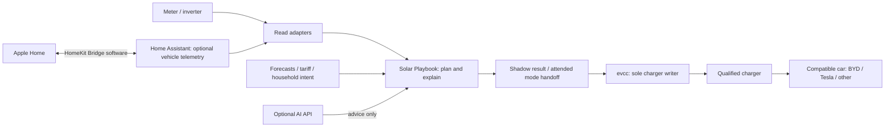

# Solar Playbook

**A working multi-brand home-energy alpha for a charged car, useful solar and less daily admin.**

Run it on a suitable Raspberry Pi, small PC, existing server or Mac. Read a local energy meter directly or through Home Assistant, plan a charging goal, and use evcc as the integration boundary for different chargers and cars. BYD, Tesla and other compatible vehicles can use an energy request without a vehicle API; optional telemetry adds a battery-percentage target. Cloud AI can explain the result. No local model or GPU is required.

**v0.2.0 — 13 October 2026:** simulation, read-only meter/vehicle/controller adapters, and one explicitly enabled **attended evcc mode handoff**. Normal planning and demo commands make no equipment changes. The optional handoff can persistently change evcc's mode and thereby affect charging; it is not an unattended controller. **No equipment combination is field qualified yet.**

## Try it in two minutes

Python 3.11 or later. The offline demo has **no third-party runtime dependencies**, subscription or API-key requirement. It needs no network after the source is downloaded.

```sh
git clone https://github.com/RADobson/solar-playbook.git
cd solar-playbook
python3 -m solar_playbook device-demo --out out/devices
open out/devices/report.html            # macOS; otherwise open in your browser
python3 -m unittest discover -s tests -v
```

`out/devices/devices.json` shows a synthetic meter observation, an offline 15 kWh wall-energy request, and an evcc mode **preview**. The report simulates a day. These are linked demonstrations of the contracts, not a real meter-to-charger control loop.

Try the same request on a cloudy day, with no car account:

```sh
python3 -m solar_playbook demo --scenario cloudy --vehicle-request examples/vehicle-offline.json --out out/cloudy
python3 -m solar_playbook plan out/cloudy/input.json --out out/replay
```

Other scenarios are `sunny`, `away`, `impossible` and `stale`; the last two deliberately return exit code 2 without selecting a plan. All bundled dates, loads, capacities and tariffs are **synthetic**, not an equipment recommendation or bill estimate.

## The big picture



HomeKit Bridge is software inside Home Assistant; the supplied request helpers still need commissioning and wiring into a future household workflow. A HomePod/Apple TV is a separate hub for remote Apple Home access. The optional Tesla ESP32 route remains a link to the **car**, not the Wall Connector, and is distinct from the multi-brand charger path.

evcc must already have its own commissioned meter, charger, limits and policy. `smart` follows that policy, which can include tariff-based grid charging and battery preferences; it does not mean “solar only.” A handoff does not upload the simulator's current-by-current schedule.

## What works in this release

| Component | Status |
|---|---|
| DC-coupled solar/battery/AC energy simulator | Implemented; conservation and limits tested |
| EV candidate scheduling, tariffs, departure deadline, availability | Implemented; five strategies evaluated |
| Solar above the AC inverter limit flowing into the battery | Implemented in the reference model |
| HTML/JSON reports and replayable input | Implemented |
| BoM XML weather-context parser | Implemented against synthetic schema fixtures; live product commissioning pending |
| Home Assistant REST entity reader | Implemented; mocked transport tests; local site not connected |
| Shelly Pro 3EM and mapped HA grid-power readers | Implemented; units, signs and timestamp provenance tested; read-only, no per-phase protection |
| Brand-neutral energy request and HA SOC target conversion | Implemented; explicit wall/battery energy basis; synthetic BYD mapping, no verified vehicle account |
| evcc 0.317.1 state read and mode preview | Implemented against documented contract and mocked transport |
| Optional attended evcc mode handoff | One bounded `off` / `smart` / `now` request with preflight gates and read-back; disabled by default; resulting mode persists |
| Local Ollama structured explanation with fallback | Implemented; mocked tests; model not installed or benchmarked here |
| OpenAI Responses, Claude Messages, compatible chat API adapters | Implemented; mocked contract tests; no paid calls made |
| Persistent daily call cap and monthly request allowance | Implemented; not a provider billing guarantee |
| Original planner proposal-eligibility contract | Still a pure function; does not execute a simulated charging trajectory |
| Home Assistant/HomeKit helper configuration | Supplied template; UI requests only; HA validation pending |
| Wattwatchers / Energex history / direct BYD login / direct OCPP server | Documented integration routes; not implemented here |
| Live forecast downloads and site PV calibration | Installation/design documented; not automated |
| Direct battery/vehicle commands, daemon, watchdog, automatic replanning | Future work; no field qualification or automatic restoration supplied |

An upstream driver listing is not a tested installation. Read the [compatibility matrix and evidence levels](docs/COMPATIBILITY.md). The planner evaluates five candidate schedules for one EV and a single-phase model; it does not model grid charging the home battery, battery export, outages, V2G, temperature derating, or second-by-second protection. See [model limits](docs/ENGINEERING.md).

## Start here

1. [Multi-brand design and control boundaries](docs/MULTIBRAND_DESIGN.md) · [project plan](docs/PROJECT_PLAN.md)
2. [Metering and smart-meter APIs](docs/METERING.md) · [equipment compatibility](docs/COMPATIBILITY.md)
3. [Installation and BYO device guide](docs/INSTALL.md) · [integration commands](docs/INTEGRATIONS.md)
4. [Commissioning and recovery](docs/COMMISSIONING.md) · [validation evidence](docs/VALIDATION.md)
5. [Engineering model](docs/ENGINEERING.md) · [weather and data rights](docs/WEATHER.md)
6. [Business case](docs/BUSINESS.md) · [upstream licences and entitlements](docs/DEPENDENCIES.md)
7. [Sources](docs/SOURCES.md) · [optional Mac notes](docs/INSTALL_MAC.md)

## Optional integrations

Copy `examples/ai-config.json` into the ignored `private/` directory, choose a provider/model, explicitly enable it and set its key through the configured environment variable. See [AI providers and costs](docs/AI_PROVIDERS.md).

```sh
python3 -m solar_playbook demo --ai-config private/ai-config.json --out out/explained
```

The configuration ships disabled. Advice is recorded in `report.json`; it cannot modify the plan. API use is optional, and provider charges are separate from any consumer chat subscription. The local planner continues without internet or AI. An existing Ollama installation remains an optional `--ollama` adapter; it is not the recommended hardware baseline.

For a **read-only** HA check, set `HA_TOKEN` in your shell environment privately; do not paste it into an issue, commit, command-line argument or screenshot:

```sh
python3 -m solar_playbook ha-read sensor.YOUR_ENTITY --url http://homeassistant.local:8123
```

Replace the placeholder with an actual lowercase entity ID. Entity IDs and units depend on your installation. Output can contain private household data: keep it local.

To parse a BoM XML file you obtained for an authorised use:

```sh
python3 -m solar_playbook bom private/forecast.xml --area YOUR_AREA_AAC
```

This extracts weather context, **not solar production predictions**. BoM has free personal-use feeds; commercial and richer products have different terms. No BoM data is bundled in this repository.

## Contributing

See [CONTRIBUTING.md](CONTRIBUTING.md). The highest-value next contribution is a recorded, anonymised commissioning test against a real site. Hardware changes need telemetry, a rollback procedure and test evidence. Do not submit household credentials or live VINs.

Our code is [MIT licensed](LICENSE). Linked components retain their licences and service terms; some evcc charger drivers require sponsor tokens. There are recurring and one-time upstream options to assess for each installation. This project is independent of the equipment vendors, Apple and the Bureau of Meteorology.
