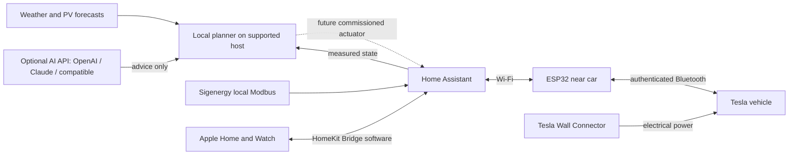

# Solar Playbook

**An open home-energy project for people who want a charged car, useful solar and less daily admin.**

Run the planning software on a modest always-on device: a suitable Raspberry Pi, a small PC, an existing server or a Mac. Use Home Assistant to connect the house, an ESP32 near the driveway to talk to the Tesla over Bluetooth, and Apple Home as the familiar interface. Optional cloud AI explains the plan through OpenAI, Claude or a compatible provider. No local model or GPU is required.

**v0.1 is a working simulation and read-only integration alpha. It does not control your inverter, battery or vehicle.** The live commissioning work requires the actual equipment and is documented, rather than represented as already tested.

## Try it in two minutes

Python 3.11 or later. The core has **no third-party runtime dependencies**, subscription, API key or internet requirement.

```sh
git clone https://github.com/RADobson/solar-playbook.git
cd solar-playbook
python3 -m solar_playbook demo --out out/sunny
open out/sunny/report.html              # macOS; otherwise open in your browser
python3 -m unittest discover -s tests -v
```

Try `--scenario cloudy`, `away`, `impossible` or `stale`. Give each run a different `--out` directory. The last two deliberately return exit code 2 and do not select a plan.

```sh
python3 -m solar_playbook demo --scenario cloudy --out out/cloudy
python3 -m solar_playbook plan out/cloudy/input.json --out out/replay
```

The JSON input is the provider-neutral contract. Edit the generated copy for your own experiments. All bundled defaults, dates, loads, battery capacities and tariffs are **synthetic**. They are not an equipment recommendation or an estimate of your bill.

## The big picture



The ESP32 communicates with the **car**, not the Wall Connector. The car adjusts how much current it draws. HomeKit Bridge is an integration inside Home Assistant. The main host can be customer supplied or installer supplied. A HomePod/Apple TV is a separate Apple home hub for remote Home access and Apple home automations.

## What works in this release

| Component | Status |
|---|---|
| DC-coupled solar/battery/AC energy simulator | Implemented; conservation and limits tested |
| EV candidate scheduling, tariffs, departure deadline, availability | Implemented; five strategies evaluated |
| Solar above the AC inverter limit flowing into the battery | Implemented in the reference model |
| HTML/JSON reports and replayable input | Implemented |
| BoM XML weather-context parser | Implemented against synthetic schema fixtures; live product commissioning pending |
| Home Assistant REST entity reader | Implemented; mocked transport tests; local site not connected |
| Local Ollama structured explanation with fallback | Implemented; mocked tests; model not installed or benchmarked here |
| OpenAI Responses, Claude Messages, compatible chat API adapters | Implemented; mocked contract tests; no paid calls made |
| Persistent daily call cap and monthly request allowance | Implemented; not a provider billing guarantee |
| Freshness, manual override and bounded command eligibility contract | Implemented as a pure function; **no actuator** |
| Home Assistant/HomeKit helper configuration | Supplied template; UI requests only; HA validation pending |
| Live forecast downloads and site PV calibration | Installation/design documented; not automated in v0.1 |
| Battery/vehicle commands, daemon, watchdog, automatic replanning | Future hardware commissioning milestone |

This is a finite candidate planner, not a global MILP optimiser. It does not model three-phase sites, grid charging the home battery, battery export, outages, V2G, temperature derating, or second-by-second load protection. See [model limits](docs/ENGINEERING.md).

## Start here

1. [Project plan and design decisions](docs/PROJECT_PLAN.md)
2. [Hardware-neutral installation and BYO device guide](docs/INSTALL.md) · [optional Mac notes](docs/INSTALL_MAC.md)
3. [BoM, solar forecasts and data rights](docs/WEATHER.md)
4. [Engineering model and interfaces](docs/ENGINEERING.md)
5. [Commissioning, recovery and support](docs/COMMISSIONING.md)
6. [Business case, installer partnership and pilot economics](docs/BUSINESS.md)
7. [Upstream software and licences](docs/DEPENDENCIES.md)
8. [Evidence and sources](docs/SOURCES.md)

## Optional integrations

Copy `examples/ai-config.json` into the ignored `private/` directory, choose a provider/model, explicitly enable it and set its key through the configured environment variable. See [AI providers and costs](docs/AI_PROVIDERS.md).

```sh
python3 -m solar_playbook demo --ai-config private/ai-config.json --out out/explained
```

The configuration ships disabled. Advice is recorded in `report.json`; it cannot modify the plan. API use is optional, and provider charges are separate from any consumer chat subscription. The local planner continues without internet or AI. An existing Ollama installation remains an optional `--ollama` adapter; it is not the recommended hardware baseline.

For a **read-only** HA check, set `HA_TOKEN` in your shell environment privately; do not paste it into an issue, commit, command-line argument or screenshot:

```sh
python3 -m solar_playbook ha-read sensor.YOUR_ENTITY --url http://homeassistant.local:8123
```

Replace the placeholder with an actual lowercase entity ID. Entity IDs and units depend on your installation. Output can contain private household data: keep it local.

To parse a BoM XML file you obtained for an authorised use:

```sh
python3 -m solar_playbook bom private/forecast.xml --area YOUR_AREA_AAC
```

This extracts weather context, **not solar production predictions**. BoM has free personal-use feeds; commercial and richer products have different terms. No BoM data is bundled in this repository.

## Contributing

See [CONTRIBUTING.md](CONTRIBUTING.md). The highest-value next contribution is a recorded, anonymised commissioning test against a real site. Hardware changes need telemetry, a rollback procedure and test evidence. Do not submit household credentials or live VINs.

Our code is [MIT licensed](LICENSE). Linked upstream components retain their own licences. This project is independent of Tesla, Sigenergy, Apple and the Bureau of Meteorology.
