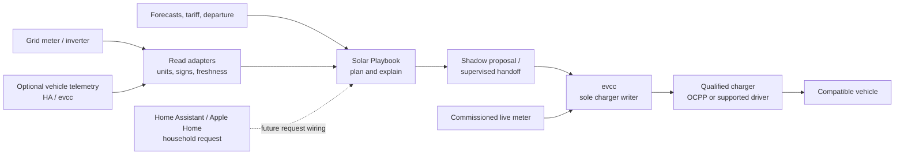

# A portable design for different meters, chargers and cars

Solar Playbook's job is to turn household intent and energy information into a reviewable plan. The multi-brand extension gives that plan a common measurement and charging-request boundary. It deliberately reuses evcc for communication with chargers, so adding a BYD or a different wall charger does not require a new end-to-end application.

The target installation has three everyday controls: **automatic**, **charge now**, and **pause**. Home Assistant provides the engineering view; its HomeKit Bridge can expose selected household requests in Apple Home. The same software can run on a qualified small ARM64 or x86-64 host. Cloud AI remains optional and has no charger credentials or control authority.

## The data and command path

The two meter arrows describe separate responsibilities: Solar Playbook needs data to assess and explain plans; evcc needs its own commissioned live data for charging regulation. Installing our meter reader does **not** automatically configure evcc's meter, site limits or charger.

## Boundaries implemented in this release

The release adds normalized meter readings, an optional vehicle-SOC contract, explicit energy-versus-SOC target conversion, evcc state reading and a bounded mode-handoff path. The default path produces a shadow result. Synthetic and mocked-interface tests exercise these contracts. There is no real-site qualification yet.

The handoff is a supervised integration step, not a daemon. It does not continually recalculate schedules, supervise physical power, or revoke settings after a host crash. The simulator's detailed power schedule is not automatically uploaded as an evcc schedule. An evcc mode request is a limited request to its existing controller, not proof that every objective in a Solar Playbook simulation has been enforced.

The interface provides `meter-read CONFIG`, `evcc-read CONFIG`, and `charge-mode CONFIG MODE --expected-mode MODE`. The last command previews by default. A real request additionally requires `--apply --attended` and the enabled/commissioned site gates. Its only write is one evcc mode request: `off`, `smart` or `now`. The contract is pinned to evcc **0.317.1**; unknown versions fail closed. No charger current, phase, inverter or battery settings are written by Solar Playbook. For full configuration and runnable examples, use [installation](INSTALL.md).

Before sending a mode request, the adapter checks the configured loadpoint identity, optional vehicle binding, observed mode and the commissioned controller limits/readiness. Independent limits and a tested fallback must be declared in the site configuration. These declarations are commissioning evidence the installer must actually establish; software cannot establish them by reading a checkbox. A read-back confirms evcc's mode only. It does not establish actual charging current or successful battery charging. An intervening manual change can still race the request because the upstream mode API offers no atomic comparison-and-set here; attended use remains essential. [Compatibility](COMPATIBILITY.md) distinguishes a tested interface from a tested charger/car combination.

## One owner for every decision

| Decision / setting | Owner in the proposed installation |
|---|---|
| Electrical protection and installed current limits | Installed equipment and commissioned electrical design |
| Actual charger enable/current/phase operations | evcc and its qualified charger driver |
| Immediate household override | Owner through the one active control interface |
| Proposed energy strategy and explanation | Solar Playbook |
| Battery operation | Native battery controller initially; future coordination needs explicit ownership |
| Optional prose and bounded suggestions | AI provider, with no equipment tools |

Do not enable a second HA automation, cloud tariff service or native charger schedule that continually writes the same settings. Native electrical safeguards are not to be disabled as part of making software the single writer. If a native dynamic-load manager and evcc both affect current, verify their supported interaction with the supplier before commissioning that combination.

OCPP is a communications protocol, not a compatibility guarantee. Required command behavior, metering, connection recovery and exact firmware still need testing. The project makes evcc the charger integration boundary and keeps site-specific exceptions in the qualification record, rather than growing a collection of direct vendor writes.

## Energy requests before percentage promises

An energy request works without a vehicle account: “deliver another 15 kWh at the charger.” State the measurement boundary clearly. Fifteen kWh delivered on the AC side is not fifteen kWh stored in the battery; conversion losses and cabin conditioning consume some energy.

A percentage request needs more context: the correctly identified car, a fresh starting SOC, usable battery capacity, the requested target, and an explicit efficiency assumption. For example, a hypothetical 60 kWh usable battery going from 40% to 70% needs 18 kWh stored. At 90% assumed charging efficiency, the corresponding AC estimate is 20 kWh. It is an estimate to validate against real sessions.

If SOC becomes unavailable, do not reinterpret “reach 80%” as “add 80%” or silently switch to an arbitrary energy amount. Show the lost capability and retain a separately chosen owner fallback. The car's own charge limit may prevent the requested result; a deadline that is physically impossible should be reported early, not hidden by extra retries.

With several cars, separate the **vehicle profile**, **loadpoint**, and **charging session**. Assign a car to a session explicitly or through a verified identifier. A default vehicle is convenient for a dedicated parking space; it is unsafe evidence for a shared charger. A session-energy counter can reset when the vehicle unplugs, so do not carry its “energy still required” arithmetic into the next session without reconciliation. Joint optimisation of several EVs is a future feature; the present planner remains single-EV/single-phase.

## Timing and failure behavior

There are three time scales. The equipment and active controller handle electrical changes. A deterministic planner considers forecasts and deadlines. Optional AI explains outcomes or helps capture preferences. A cloud-model response must never sit in the fast charging loop.

| Event | Present boundary | Requirement before unattended use |
|---|---|---|
| AI or weather service fails | Deterministic planning can continue with explicit input limitations | Cache forecasts, record expiry and use a documented conservative strategy |
| Meter response is stale or invalid | Reader fails; readings remain ineligible to authorise control | evcc/charger must have a tested independent loss-of-meter behavior; the CLI is not a continuous interlock |
| Vehicle SOC or identity disappears | Percentage-based requests lose their evidence | Preserve an explicit owner-selected energy/native fallback |
| Network write times out | Outcome may be unknown; do not assume a failed command had no effect | Reconcile actual state and physical feedback before another action |
| evcc or host restarts | The CLI supplies no continuous supervision | Discover persisted mode/current, discard stale proposals and re-establish ownership |
| Owner changes the charging mode | The latest observed state is the comparison point | Durable override ownership and expiry; no automatic write-back over the owner |
| Car refuses to resume | API acceptance is insufficient | Detect lack of physical charging and present a useful recovery step |

A proposal expiry limits when a proposal may be applied. It is **not a lease on the charger's resulting mode**. If the mode is changed and the process exits, the setting can persist. Automatic rollback needs a separately commissioned supervisor, actual feedback and crash recovery. This release makes no watchdog claim.

Use start/stop delays and the car/charger's qualified minimum current. Around 6 A, nominal 230 V AC implies approximately 1.4 kW on one phase and 4.1 kW on three; repeated interruption can prevent some cars from resuming. Phase switching also needs explicit support and testing. These are controller/installation settings, not numbers for an AI model to invent. [evcc solar-charging behavior](https://docs.evcc.io/en/features/solar-charging/)

## Battery and grid constraints

A home battery can hide grid demand by discharging into the EV. An apparently low grid import therefore does not prove that the car is using only fresh solar. Observe battery power and reserve when assessing plans; commission the battery/controller priority behavior separately. Keep the native battery controller in charge initially and avoid battery register writes in this release. [evcc home battery coordination](https://docs.evcc.io/en/docs/features/battery/)

Three-phase sites need phase-aware protection. evcc's current load-management feature is marked experimental and lists limitations, including battery grid-charging accounting and session rebalancing. Its documentation also flags a future commercial-use licence. That feature must not be the basis of an unqualified promise that any site's overload protection or multi-car allocation is solved. [evcc load management](https://docs.evcc.io/en/features/loadmanagement/)

For export-constrained sites, record the permitted export level separately from the feed-in price. Do not change an approved inverter/export limit to improve a simulated result. The first implementation can report what is measurable and flag a curtailed-solar limitation; it does not negotiate new network approval or alter protection settings.

## From prototype to an installation service

The first useful offer is a fixed-scope assessment and commissioning service for a small supported-equipment list. A BYO host must pass storage, power recovery, networking and backup checks. A supplied host should use the same software and site contract so the business does not depend on a particular computer brand.

Before a commercial pilot, add and verify: a persistent supervisor, request authentication, state reconciliation after restarts, explicit override ownership, bounded retry behavior, actionable alerts, backup/restore and a pinned update/rollback process. Run the failure tests on a real meter/charger/car combination and publish anonymised qualification results. A successful small pilot is evidence to widen the support list; a long list of upstream drivers is not.

Keep customer credentials and energy history at the home by default. Remote support should use owner-approved access with a visible way to revoke it. Cloud AI receives a deliberately reduced numeric summary; precise address, vehicle identifiers and credentials are unnecessary for explaining a charging plan. Review each selected provider's data handling before enabling it for a customer.

Quote hardware, commissioning, upstream entitlements, any metering/weather service and optional support separately. Check evcc's current installer and load-management terms before packaging a commercial offering. The business can earn its margin through a dependable setup and a clean handover while the homeowner retains normal charging and control of their accounts.

Design and upstream evidence reviewed **13 October 2026**. This document distinguishes the implemented prototype boundary from the additional work required for unattended operation.
